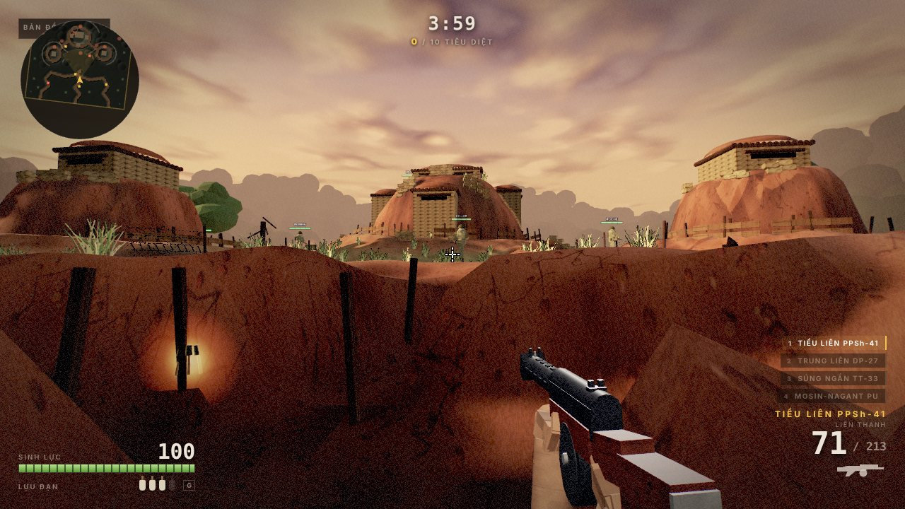
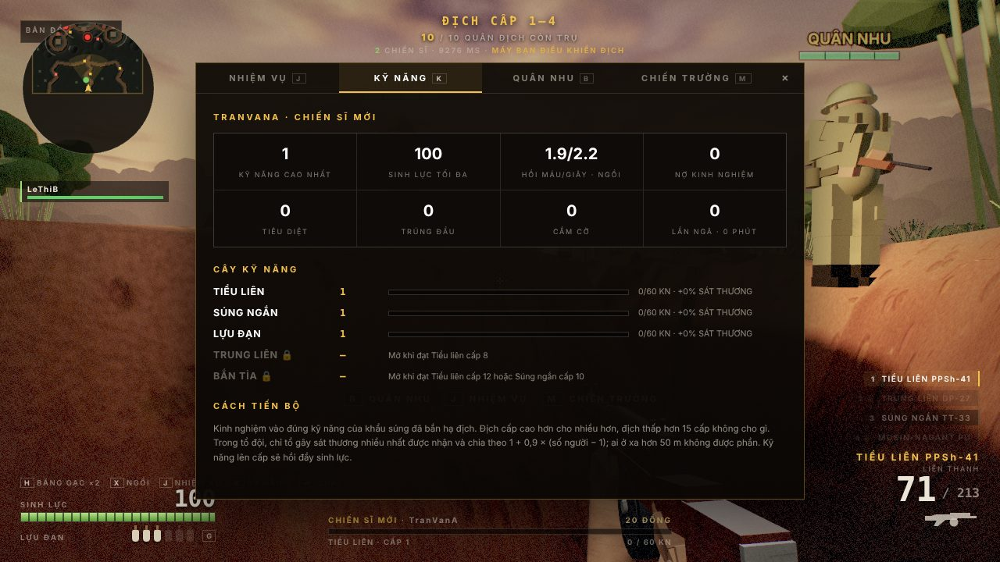
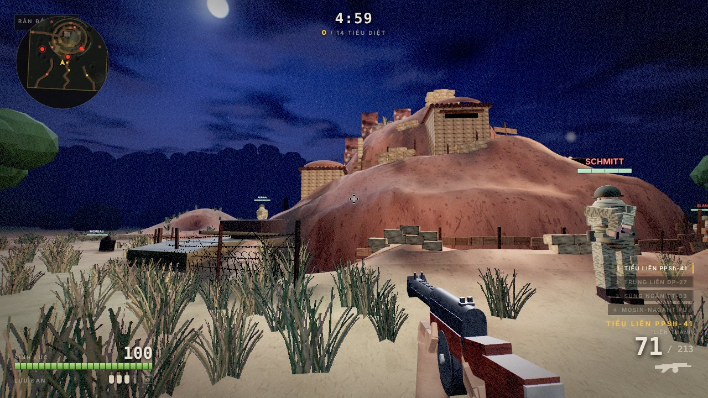
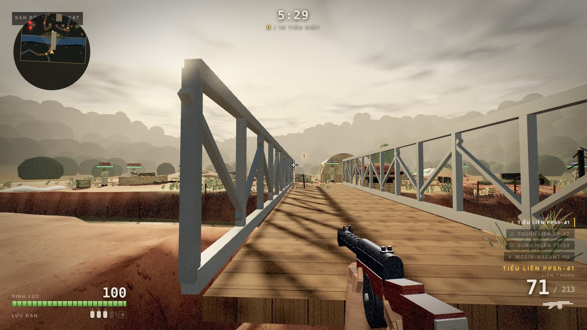

# Điện Biên Phủ 1954

Game bắn súng góc nhìn thứ nhất, năm màn, tái hiện chiến dịch Điện Biên Phủ (13/3 – 7/5/1954).
Một file HTML duy nhất, không build step, không có file ảnh, âm thanh hay mô hình nào — địa hình,
vũ khí, quân phục, bầu trời và mọi âm thanh đều được sinh ra lúc chạy.



Game dựng trên engine của [Operation Ironhold](../README.md) (`../index.html`): giữ nguyên renderer,
post-processing tự viết, hệ va chạm, AI địch, combat director và tổng hợp âm thanh Web Audio; thay
bản đồ bãi container bằng chiến trường heightfield có đồi, giao thông hào và hố bom, rồi thêm các
cơ chế riêng cho bối cảnh 1954.

## Chạy game

Mở `dienbienphu/index.html` bằng trình duyệt desktop. Hoặc chạy server ở thư mục gốc repo:

```bash
python -m http.server 8123
```

rồi vào `http://127.0.0.1:8123/dienbienphu/`. Chọn trận ở menu chiến dịch, đọc lệnh tác chiến,
bấm **XUẤT KÍCH** — cú click đó cấp pointer lock. `Esc` để tạm dừng.

Cần WebGL và Pointer Lock; không hỗ trợ cảm ứng. Nguồn ngoài duy nhất là three.js r128 từ CDN.

## Chế độ MMORPG

Thêm `?mmo=1` (`dienbienphu/?mmo=1`) để vào chế độ trực tuyến: năm chiến trường thành năm vùng của
một máy chủ bền vững, nhiều người cùng đánh, luyện kỹ năng theo từng khẩu súng, nhận nhiệm vụ, lập tổ
đội, chat, nhặt chiến lợi phẩm. Máy chủ (`node mmo/server.mjs`) và luật chơi mô phỏng theo Ryzom Core;
không có máy chủ thì vẫn chơi một mình bằng shard chạy ngay trong tab. Xem [mmo/README.md](../mmo/README.md).



## Năm màn

| Màn | Trận | Thời điểm | Mục tiêu | Đặc trưng |
| --- | --- | --- | --- | --- |
| 1 | Đồi Him Lam (Béatrice) | 13/3/1954, 17:05 | Diệt 10 địch, cắm cờ trên đỉnh | Hoàng hôn, pháo ta dồn dập trên ba mỏm đồi, xuất phát từ giao thông hào |
| 2 | Đồi Độc Lập (Gabrielle) | Rạng sáng 15/3/1954 | Diệt 12 địch, cắm cờ | Sương mù, pháo sáng của địch, hai tuyến hào, trận địa cối 120 ly |
| 3 | Sân bay Mường Thanh | Tháng 4/1954 | Diệt 12 địch, đặt bộc phá kho đạn | Mưa, đường băng thép PSP bị hào cắt ngang, xác Dakota, dù tiếp tế |
| 4 | Đồi A1 (Éliane 2) | 20:30 ngày 6/5/1954 | Diệt 14 địch, cắm cờ | Đêm, mở màn bằng khối bộc phá 960 kg, xác xe tăng M24, tàn tích biệt thự |
| 5 | Hầm Đờ Cát | Chiều 7/5/1954 | Vượt cầu, diệt 14 địch, cắm cờ trên nóc hầm | Cầu Mường Thanh, sông Nậm Rốm lội được, hầm chỉ huy mái vòm tôn |





Mỗi màn là một lần tải trang với `?m=1` … `?m=5` (thêm `&b=1` để mở thẳng lệnh tác chiến). Tiến độ và
thời gian tốt nhất lưu trong `localStorage` của trình duyệt; xóa dữ liệu trang là mất, game vẫn chạy
bình thường. Thắng màn 5 sẽ hiện tổng kết toàn chiến dịch.

## Điều khiển

| Phím | Hành động |
| --- | --- |
| `W` `A` `S` `D` | Di chuyển |
| Chuột | Ngắm / xoay |
| Chuột trái | Bắn |
| Chuột phải | Ngắm bằng thước ngắm (ADS) |
| `Shift` | Chạy; nín thở khi ngắm ống ngắm PU |
| `Ctrl` / `C` | Khom người — trong giao thông hào là kín hoàn toàn |
| `Space` | Nhảy, nhảy hai lần, giữ để leo lên mép cao |
| `R` | Thay đạn |
| `G` | Ném lựu đạn chày |
| `E` (giữ) | Cắm cờ / đặt bộc phá ở mục tiêu |
| `1` `2` `3` `4` / lăn chuột | Đổi vũ khí |
| `V` | PPSh-41: liên thanh ↔ phát một |

## Vũ khí

| Ô | Vũ khí | Băng | Dự trữ | Đặc điểm |
| --- | --- | --- | --- | --- |
| 1 | Tiểu liên PPSh-41 | 71 (băng trống) | 213 | 900 phát/phút, sát thương thấp, thay băng chậm |
| 2 | Trung liên DP-27 | 47 (hộp đạn đĩa) | 141 | 560 phát/phút, đạn súng trường, nặng (đi chậm 12%) |
| 3 | Súng ngắn TT-33 | 8 | 56 | Rút nhanh nhất |
| 4 | Mosin-Nagant PU | 5 | 30 | Lên đạn bằng tay, ống ngắm PU 3,5× với lưới chữ T |
| G | Lựu đạn chày | — | 3 (tối đa 4) | Nảy theo vật lý, ngòi 3 giây, bán kính sát thương 7,5 m |

Viewmodel của cả bốn khẩu dựng từ khối hình học, có báng gỗ và tay trần áo bộ đội. Khi ngắm,
báng súng và tay phải được ẩn đi vì lúc đó chúng nằm dưới má người bắn chứ không nằm trước thước ngắm.

## Khác gì so với Operation Ironhold

- **Địa hình heightfield.** Một lưới độ cao 0,5 m quyết định mọi thứ: đồi là gaussian cắt cụt
  (dốc dưới ~35°), giao thông hào sâu 1,55 m khoét theo polyline với đất đắp hai bên mép, hố bom
  có gờ đất, sông Nậm Rốm khoét thành lòng lạch. `terrainH()` nội suy đúng theo cách chia tam giác
  của mesh, nên chân người, vỏ đạn và lựu đạn đều đặt lên đúng bề mặt nhìn thấy.
- **Địa hình không nằm trong danh sách raycast mặt đất.** Mười bốn lính mỗi khung hình bắn tia xuống
  năm mươi nghìn tam giác là hết ngân sách khung hình; `groundAt()` lấy max của tia vào vật thể và
  phép tra lưới. Đạn và tầm nhìn (LOS) vẫn bắn vào các ô địa hình, nên đỉnh đồi che được người.
- **Hai lớp lưới cho đạo cụ.** GPU vẽ một mesh gộp cho mỗi vật liệu trên toàn bản đồ; tia đạn thử
  vào các mesh chia ô 15 m không thêm vào scene. Số draw call của cảnh tĩnh giảm từ ~470 xuống ~110.
- **Tầm nhìn theo màn.** Ban đêm và trong sương, địch chỉ thấy người ở cự ly gần; pháo sáng nâng tầm
  nhìn của chúng lên tối đa. Bảng tên địch cũng chỉ hiện trong tầm nhìn đó.
- **Lựu đạn hai phía.** Địch mất dấu người chơi sau vật che sẽ ném lựu đạn trứng vào vị trí cuối cùng
  thấy được, có cảnh báo trên HUD.
- **Liên lạc vô tuyến bị nghe lén** bằng tiếng Pháp, kèm lời dịch tiếng Việt.
- **Ánh sáng là tập cố định.** three.js biên dịch số đèn vào shader, nên đèn nổ, đèn lửa và pháo sáng
  được tạo sẵn lúc tải rồi chỉ di chuyển và đổi cường độ.
- **Màu sương mù được chuyển sang linear.** Nếu để nguyên giá trị sRGB, mọi ngọn đồi xa hơn trăm mét
  tan thành một dải sáng hơn cả bầu trời.

## Về độ chính xác lịch sử

Mốc thời gian, địa danh, tên cứ điểm và kết quả từng trận theo các tài liệu phổ biến về chiến dịch.
Những điểm đã giản lược để chơi được:

- Mỗi trận được nén vào một khu vực 60 × 60 m; số lượng quân, khoảng cách và địa hình đều thu nhỏ.
- Tên lính địch là họ người Pháp phổ biến, không phải nhân vật có thật.
- Quân phục địch dùng chung kiểu lính dù (rằn ri «da thằn lằn», mũ M1) cho mọi màn, dù thực tế các
  cứ điểm do nhiều đơn vị khác nhau trấn giữ.
- Bộ đội ta ở Điện Biên Phủ dùng vũ khí từ nhiều nguồn; bốn khẩu trong game là những mẫu tiêu biểu.

## Kiểm thử

`tools/dbp-smoke.mjs` (chỉ dùng khi phát triển) chạy cả năm màn trong Chromium headless: kiểm tra
không có lỗi trang, mọi tuyến tuần tra nằm trên vùng đi tới được, bắn hạ được một lính, lựu đạn
giết được người đứng cạnh, diệt hết địch thì mở khóa mục tiêu, và giữ `E` thì cắm được cờ/đặt bộc phá.

```bash
node tools/dbp-smoke.mjs          # cả năm màn
node tools/dbp-smoke.mjs 4        # chỉ đồi A1
```

Đặt `THREE_JS=/đường/dẫn/three.min.js` nếu máy không truy cập được CDN.

Chế độ MMORPG có bộ kiểm thử riêng: `node --test mmo/test` cho shard và `node tools/mmo-smoke.mjs`
chạy máy chủ thật với hai trình duyệt headless — xem [mmo/README.md](../mmo/README.md#kiểm-thử).
