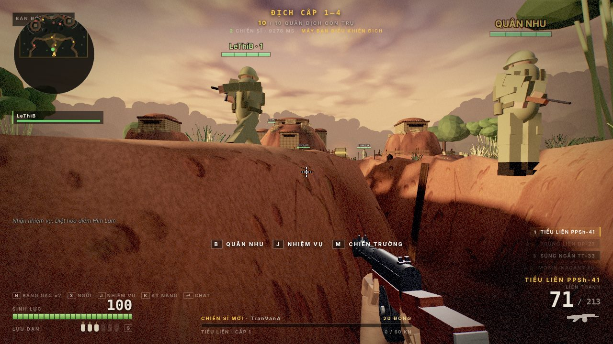

# Điện Biên Phủ 1954 — chế độ MMORPG

Chế độ trực tuyến cho [game Điện Biên Phủ](../dienbienphu/README.md): năm chiến trường là năm vùng
của **một máy chủ bền vững** (shard). Nhiều người chơi cùng đánh quân Pháp (co-op PvE), luyện kỹ năng
theo từng khẩu súng, nhận nhiệm vụ, lập tổ đội, chat theo kênh, nhặt chiến lợi phẩm và mua quân nhu.
Nhân vật được lưu trên máy chủ, đăng nhập lại vẫn còn.

Kiến trúc và luật chơi mô phỏng theo [Ryzom Core](https://github.com/ryzom/ryzomcore), mã nguồn mở của
MMORPG Ryzom. Mọi con số lấy từ Ryzom đều ghi rõ file nguồn ngay trong code (`shard/rules.mjs`).



## Chạy

**Chơi chung** — cần Node 18 trở lên, không cài gói nào:

```bash
node mmo/server.mjs                 # http://localhost:8080/
node mmo/server.mjs --port 9000 --data /srv/dbp-data --host 0.0.0.0
```

Server vừa phục vụ file tĩnh của repo vừa mở WebSocket ở `/shard`, nên chỉ cần mở
`http://<máy-chủ>:8080/` — trang tự chuyển tới `dienbienphu/?mmo=1` với ô máy chủ điền sẵn.
Nhân vật lưu thành file JSON trong `mmo/data/` (đã nằm trong `.gitignore`), ghi kiểu
tmp + rename để không bao giờ còn nửa file. `Ctrl+C` lưu hết rồi mới tắt.

**Chơi một mình** — mở `dienbienphu/?mmo=1` qua http (kể cả GitHub Pages) rồi bấm
**SHARD CỤC BỘ**: chính mã shard ở trên chạy ngay trong tab, nhân vật lưu ở `localStorage`.
Không chạy được từ `file://` vì trình duyệt chặn `import()` module ở đó.

Tên mới tự tạo nhân vật; mật khẩu băm bằng `scrypt` có salt. Một nhân vật chỉ một phiên —
đăng nhập ở chỗ khác sẽ đẩy phiên cũ ra.

## Điều khiển thêm

| Phím | Hành động |
| --- | --- |
| `Enter` | Chat. `/s` nói (16 m), `/sh` hét (48 m), `/t` tổ đội, `/z` cả chiến trường, `/u` toàn máy chủ, `/w tên lời` nói riêng, `/r` trả lời |
| `/moi tên` · `/dongy` · `/roi` · `/kick tên` · `/who` | Mời vào tổ · nhận lời mời · rời tổ · mời ra · ai đang trực tuyến |
| `J` | Nhiệm vụ |
| `K` | Kỹ năng và hồ sơ nhân vật |
| `B` | Trạm quân nhu (trong vòng 9 m quanh điểm tập kết) |
| `M` | Năm chiến trường — hành quân sang vùng khác |
| `H` | Băng gạc: hồi 40 sinh lực trong 4 giây |
| `X` | Ngồi nghỉ: hồi sinh lực nhanh gấp đôi, đứng dậy khi di chuyển hoặc bắn |

## Kiến trúc: một shard Ryzom thu nhỏ

Ryzom chạy mỗi phần của thế giới thành một service riêng, nói chuyện với nhau qua lớp
"unified network" của NeL. Ở đây mỗi service là một module, nối với nhau bằng một bus trong tiến trình
(`shard/bus.mjs`), giữ nguyên ranh giới trách nhiệm:

| Service Ryzom | File | Giữ cái gì |
| --- | --- | --- |
| `tick_service` | `shard/shard.mjs` | Nhịp 10 Hz (`_TickTimeStep = 0.1f`, tick_service.cpp) |
| `ryzom_welcome_service` + login của EGS | `services/login.mjs` | Tài khoản, phiên, token nối lại |
| `entities_game_service` | `services/entities.mjs` | Nhân vật, kỹ năng, XP, cái chết, túi đồ, hòm tiếp tế, chiến lợi phẩm |
| `ai_service` | `services/ai.mjs` | Máu, cái chết, hồi sinh của quân địch; mục tiêu cứ điểm; ai mô phỏng AI |
| mission manager (EGS) | `services/missions.mjs` | Các bước nhiệm vụ và phần thưởng |
| team manager (EGS) | `services/teams.mjs` | Tổ đội, khung trạng thái tổ |
| `input_output_service` | `services/chat.mjs` | Kênh chat |
| `frontend_service` | `services/frontend.mjs` | Tầm nhìn và độ ưu tiên gửi dữ liệu cho từng client |
| `backup_service` | `services/backup.mjs` | Lưu nhân vật định kỳ |

`shard/` không đụng tới mạng hay ổ đĩa: host đưa vào chỗ lưu, hàm băm và đường truyền. Nhờ vậy
cùng một mã chạy dưới Node sau WebSocket (`server.mjs`, `net/websocket.mjs` — RFC 6455 tự viết,
không phụ thuộc) và trong trình duyệt (`local.mjs`).

### Một khác biệt có chủ ý

Server Ryzom có bản đồ va chạm (PACS) nên tự tính đường đi và tầm nhìn cho quái. Chiến trường ở đây
lại do renderer của client sinh ra, server không có hình học. Vì vậy AI quân Pháp chạy trên **một
client mỗi vùng** — "simulation owner", người vào vùng sớm nhất — client đó gửi trạng thái lính lên
10 lần/giây, shard phát lại cho người khác. Khi owner rời đi, shard trao vùng cho người ở lâu nhất.
Shard vẫn là **trọng tài duy nhất** về máu địch, cái chết, XP, chiến lợi phẩm và hồi sinh: người bắn
chỉ gửi "hit claim", shard kiểm tra kỹ năng đã mở, tốc độ bắn tối đa của súng, tầm bắn và sát thương
tối đa mỗi phát rồi mới trừ máu. Mỗi lính mang số thế hệ `gen` tăng sau mỗi lần hồi sinh, nên phát bắn
hay gói trạng thái của "kiếp trước" bị bỏ qua.

Đây là game hợp tác: máu và vị trí người chơi do client quyết (shard chỉ kẹp trong biên bản đồ). Ai sửa
client vẫn có thể bất tử — không ảnh hưởng người khác vì không có PvP, nhưng đừng dùng mô hình này cho
một game đối kháng.

## Luật chơi và nguồn trong Ryzom Core

Đường dẫn tính từ `ryzomcore/ryzom/server/src/`; riêng `game_share/` nằm ở `ryzomcore/ryzom/common/src/`.

**Kỹ năng thay cho cấp nhân vật.** Ryzom không có cấp nhân vật: hành động nào luyện kỹ năng nấy, nhánh
con mở khi nhánh cha đạt ngưỡng (`entities_game_service/player_manager/character.cpp`, cấu trúc
`SSkill` trong `entity_structure/statistic.h`). Ở đây: tiểu liên, súng ngắn, lựu đạn mở sẵn; trung liên
mở ở tiểu liên 8; súng bắn tỉa mở ở tiểu liên 12 hoặc súng ngắn 10; trần 50. Mỗi cấp kỹ năng súng
thêm 1% sát thương, chụm hơn 0,6% và thay đạn nhanh hơn 0,5%.

**Sinh lực.** `max = (đặc tính + 10) × 10` (character.cpp, hệ số trong `egs_variables.cpp`), đặc tính
tăng theo kỹ năng cao nhất. Hồi phục: ngồi `đặc tính/16 + 1,6` mỗi giây, đang hành động một nửa
phần đầu cộng 1,6 (`RegenDivisor`, `RegenReposFactor`, `RegenOffset`). Riêng game bắn súng: không hồi
khi vừa trúng đạn dưới 6 giây.

**XP khi hạ địch** (`entities_game_service/progression/progression_pve.cpp`).
`deltaLevel = kỹ năng − cấp địch`, kẹp ±50, phóng đại cho kỹ năng thấp bằng `50 / min(50, kỹ năng + 10)`.
Bảng tra hệ số là sheet thiết kế không có trong repo, nên đường cong ở đây là của game: ngang cấp đủ XP,
địch mạnh hơn cho nhiều hơn, địch yếu hơn 15 cấp không cho gì. Chỉ **nhóm gây nhiều sát thương nhất**
được nhận; chia theo `1 + (n − 1) × 0,9`; ai cách xa hơn 50 m vẫn tính vào số chia nhưng không có phần
(`XPTeamMemberDivisorValue`, `MaxDistanceForXpGain` trong `entities_game_service/egs_variables.cpp`). Tổ đội tối đa 9 người
(`TeamMaxNbMembers`, `game_share/misc_const.h`).

**Cái chết** (`entities_game_service/death_penalties.cpp`). Dưới kỹ năng 10 không bị phạt. Từ 10 trở đi
mỗi lần ngã cộng một khoản **nợ kinh nghiệm** có trần; một nửa XP kiếm được sẽ trả nợ trước; nợ cũng tự
tan theo thời gian (Ryzom 3 ngày, ở đây 30 phút). Hồi sinh sau 6 giây ở điểm tập kết với nửa sinh lực.

**Chat** (`input_output_service`, `game_share/chat_group.h`). `say` tới 1 ô, `shout` tới 3 ô, ô 16 m,
so từng trục (`MaxDistSay`, `MaxDistShout`); thêm kênh tổ, vùng, toàn máy chủ, riêng tư.

**Frontend** (`frontend_service/vision_array.h`, `distance_prioritizer.cpp`). Mỗi tick, mỗi thực thể
trong tầm nhìn của một client được cộng `10000 / khoảng cách(mm)` điểm ưu tiên; gói tin lấp từ cao xuống
thấp tới hết ngân sách; vị trí chỉ gửi lại khi thực thể đã đi xa hơn khoảng cách/tỉ lệ kể từ lần gửi
trước. Gần thì tươi từng tick, xa thì nhỏ giọt nhưng không bao giờ bị bỏ đói.

**Lưu** (`character.cpp`, `TickFrequencyPCSave`). Lưu mỗi 100 tick và khi ngắt kết nối.

**Nhiệm vụ** theo hình dạng các bước `kill`, `visit`, `loot_item` của Ryzom, thêm `kill_weapon`,
`kill_head` và `capture`. Mỗi chiến trường 3–4 nhiệm vụ, có thời gian chờ nhận lại và yêu cầu kỹ năng.
Hạ địch tính cho cả tổ trong cùng vùng.

**Thế giới bền vững.** Lính địch hồi sinh riêng lẻ sau 80–120 giây. Diệt hết thì cứ điểm mở 150 giây
để cắm cờ (hoặc đặt bộc phá ở sân bay); cắm xong, 60 giây sau quân Pháp phản kích — cả đồn sống lại và
vòng đánh bắt đầu lại.

## Giao thức

JSON qua WebSocket, mỗi thông điệp có trường `t`. Client gửi: `login`, `resume`, `join`, `pos` (10 Hz),
`hit`, `shot`, `nade`, `died`, `hp`, `skill`, `pickup`, `loot`, `use`, `buy`, `plant`, `mission`,
`missions`, `team`, `chat`, `who`, `ping`; owner gửi thêm `npcState`, `npcFire`, `npcNade`, `npcSay`.
Shard gửi: `welcome`, `joined`, `snap` (từ frontend), `pjoin`/`pleave`, `authority`, `npcHp`, `npcDie`,
`npcSpawn`, `npcFire`, `objective`, `xp`, `levelUp`, `char`, `grant`, `death`, `respawn`, `loot`,
`lootGone`, `missions`, `missionDone`, `team`, `teamInvite`, `chat`, `sys`. Mỗi kết nối tối đa 120
thông điệp/giây, mỗi khung tối đa 64 KB.

Chuyển chiến trường là tải lại trang (`?mmo=1&m=N`); client giữ token nối lại trong `sessionStorage`
nên không phải đăng nhập lại.

## Kiểm thử

```bash
node --test mmo/test          # shard: đăng nhập, quyền mô phỏng, phán xử phát bắn, XP tổ đội, nợ XP,
                              # nhiệm vụ, lưu nhân vật, ưu tiên frontend — không cần trình duyệt
node tools/mmo-smoke.mjs      # end-to-end: server thật + hai trình duyệt headless
```

`mmo-smoke.mjs` cần Playwright (đặt `THREE_JS=/đường/dẫn/three.min.js` nếu máy không ra được cdnjs).
Nó kiểm tra: người vào trước điều khiển AI, người sau nhận luồng; hai màn hình thấy nhau và thấy lính địch
ở cùng chỗ; phát bắn của người sau hạ địch trên cả hai màn hình và trả XP; chat vùng, lập tổ, chat tổ;
chết, màn hình ngã xuống, hồi sinh; owner thoát thì vùng được trao lại; tải lại trang vẫn đúng nhân vật;
shard cục bộ chạy trong tab và hành quân sang Độc Lập; nhân vật được ghi xuống đĩa.

## Giới hạn

- Mỗi vùng chỉ có 10–14 lính, chiến trường 60 × 60 m: đông hơn chục người một vùng sẽ chật.
- AI chạy trên máy owner, nên máy owner yếu thì lính của cả vùng phản ứng chậm theo.
- Shard cục bộ chỉ có một người: mỗi tab là một shard riêng.
- Không có PvP, buôn bán giữa người chơi hay guild — Ryzom có, bản thu nhỏ này dừng ở tổ đội.
